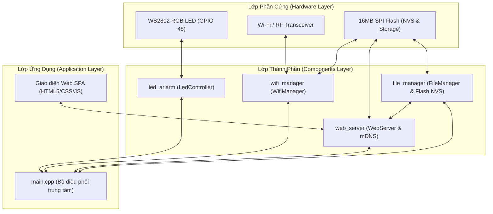

# BÁO CÁO TIẾN TRÌNH DỰ ÁN: ESP32-S3 AIR PRINTER
**Dự án:** Hệ thống máy in không dây thông minh qua Wi-Fi & Web Server (Air Printer)  
**Nền tảng:** ESP32-S3 (ESP-IDF v5.5.6)  
**Ngày cập nhật:** 19/11/2026  
**Trạng thái hiện tại:** Hoàn thành Giai đoạn 1 (Nền tảng mạng, Giao diện Web SPA, Quản lý in & Tải tệp)

---

## 1. TỔNG QUAN PHẦN CỨNG & MÔI TRƯỜNG PHÁT TRIỂN

### 1.1. Thông số phần cứng (Hardware Specifications)
* **Vi điều khiển:** ESP32-S3 (Dual-core Xtensa LX7, xung nhịp lên đến 240 MHz).
* **Bộ nhớ Flash:** 16 MB SPI Flash (Chế độ DIO, 80 MHz).
* **Bộ nhớ PSRAM:** 8 MB Octal PSRAM (Chế độ OPI, 80 MHz).
* **Đèn LED hiển thị trạng thái:** WS2812 RGB Addressable LED kết nối trực tiếp vào **GPIO 48**.
* **Bảng phân vùng Flash (`partitions.csv`):**
  * `nvs` (24 KB): Lưu thông số mạng, tên máy in tùy chỉnh.
  * `otadata` (8 KB): Lưu con trỏ cập nhật OTA.
  * `phy_init` (4 KB): Dữ liệu hiệu chuẩn RF.
  * `factory` (3 MB): Phân vùng Firmware gốc.
  * `ota_0` (3 MB) & `ota_1` (3 MB): Hai phân vùng Firmware dự phòng cho OTA.
  * `storage` (6 MB): Phân vùng lưu trữ tài liệu in (SPIFFS/FATFS).

### 1.2. Môi trường phát triển & Công cụ
* **Hệ điều hành:** Windows 10/11.
* **Bộ SDK:** ESP-IDF v5.5.6 (C/C++ Modern standard C++17/C++20, FreeRTOS).
* **Trình biên dịch:** `xtensa-esp32s3-elf-gcc` / `xtensa-esp32s3-elf-g++`.
* **Thư mục làm việc chuẩn:** `E:\ImportantData\Out_source_project\esp32-s3-air-printer`  
  *(Lưu ý: Đã đổi tên từ thư mục có dấu tiếng Việt sang không dấu để tránh lỗi trình biên dịch GCC).*

---

## 2. KIẾN TRÚC HỆ THỐNG PHẦN MỀM



---

## 3. CHI TIẾT CÁC COMPONENT ĐÃ HOÀN THÀNH

### 3.1. `components/led_arlarm` - Báo hiệu trạng thái LED RGB
* **Tệp tin:** `control_led.hpp`, `control_led.cpp`, `CMakeLists.txt`.
* **Tính năng chính:**
  * Điều khiển LED WS2812 bằng RMT peripheral thông qua component chính thức `espressif/led_strip`.
  * Thiết kế theo chuẩn **Modern C++ (RAII)**: Xóa copy constructor/assignment operator, hỗ trợ Move semantics chống rò rỉ hoặc double-free tài nguyên phần cứng.
  * Tích hợp FreeRTOS Task chạy ngầm (`ledTask`) cho các hiệu ứng bất đồng bộ mà không chặn luồng chính.
  * Các chế độ hiệu ứng (`LedPattern`):
    * `OFF`: Tắt hoàn toàn.
    * `SOLID`: Bật sáng đứng cố định.
    * `BLINK_SLOW` (1000ms): Nháy cảnh báo chậm.
    * `BLINK_FAST` (300ms): Nháy trạng thái đang xử lý nhanh.
    * `BREATHE` (Chu kỳ 3.6s): Hiệu ứng thở mượt mà theo hàm lượng giác.
* **Quy ước màu sắc trạng thái:**
  | Trạng thái hệ thống | Màu sắc | Hiệu ứng | Ý nghĩa |
  | :--- | :--- | :--- | :--- |
  | **Khởi động / AP Mode** | Xanh Dương (Blue) | `BREATHE` | Đang phát AP chờ người dùng cấu hình |
  | **Đang kết nối Wi-Fi** | Vàng (Yellow) | `BLINK_FAST` | Đang gửi xác thực tới Router |
  | **Đã vào Wi-Fi thành công**| Xanh Lá (Green) | `SOLID` | Đã nhận IP, sẵn sàng in ấn |
  | **Kết nối thất bại** | Đỏ (Red) | `BLINK_SLOW` | Sai mật khẩu hoặc mất sóng |

---

### 3.2. `components/wifi_manager` - Quản lý kết nối Wi-Fi (AP + STA)
* **Tệp tin:** `wifi_manager.hpp`, `wifi_manager.cpp`, `CMakeLists.txt`.
* **Tính năng chính:**
  * Chạy đồng thời 2 chế độ **AP + STA (`WIFI_MODE_APSTA`)**:
    * **AP Mode:** Tự động phát mạng có tên `AirPrinter-XXXX` (trong đó `XXXX` là 4 ký tự cuối của địa chỉ MAC chip), không mật khẩu (Open), dải IP mặc định `192.168.4.1`.
    * **STA Mode:** Kết nối vào mạng Wi-Fi gia đình/văn phòng.
  * **Cơ chế chống sụt áp (Anti-Brownout Detector):**
    * Tự động hạ công suất phát RF xuống 15 dBm (`esp_wifi_set_max_tx_power(60)`).
    * Áp dụng quét thụ động (`WIFI_SCAN_TYPE_PASSIVE`) với chu kỳ 120ms/kênh để triệt tiêu dòng đỉnh đột ngột gây sập nguồn khi cắm cổng USB máy tính.
  * Quản lý trạng thái hướng sự kiện bằng FreeRTOS Event Loop và hàm callback lambda.

---

### 3.3. `components/web_server` - Máy chủ Web, mDNS & Giao diện Quản lý In
* **Tệp tin:** `web_server.hpp`, `web_server.cpp`, `web_page.h`, `CMakeLists.txt`, `idf_component.yml`.
* **Tính năng chính:**
  * Khởi chạy HTTP Server trên cổng 80 với cấu hình tối ưu LRU socket purge.
  * **Định danh tên miền nội bộ (mDNS):**
    * Đăng ký dịch vụ `_http._tcp` cổng 80.
    * Cho phép người dùng tự đặt tên thân thiện (Friendly Name, ví dụ: `mayin-tang1`) và lưu vĩnh viễn vào NVS Flash.
    * Truy cập trực tiếp qua địa chỉ: `http://<tên-máy-in>.local` mà không cần nhớ địa chỉ IP.
  * **Giao diện Web SPA (Single Page Application):**
    * Được viết bằng HTML5/CSS3/JavaScript thuần, nén trực tiếp vào Flash (không cần kết nối Internet để tải CDN).
    * Thiết kế Responsive, tương thích máy tính và điện thoại thông minh.
    * **Tab 1: 📁 In Ấn & Tải File (Upload & Print):**
      * Vùng kéo thả tệp hoặc thư mục (Drag & Drop zone).
      * Nút **`📄 Chọn file`** (tải tệp lẻ) và **`📁 Chọn cả thư mục`** (sử dụng `webkitdirectory` để tải trọn gói folder).
      * Thanh % tiến trình tải lên thời gian thực.
      * Thuật toán tải lên tuần tự (*Sequential Upload*) bảo vệ bộ nhớ RAM và socket của vi điều khiển.
      * Danh sách hàng đợi in ấn hiển thị tên tệp, dung lượng kèm 2 nút thao tác: **`🖨️ In`** và **`Xóa`**.
      * **Lưu trữ bền vững trong Flash NVS:** Toàn bộ danh sách tài liệu trong hàng đợi được tự động lưu vĩnh viễn vào Flash NVS (`app_cfg`). Khi tắt nguồn hoặc khởi động lại, danh sách này vẫn hiển thị nguyên vẹn trên Web, chỉ bị xóa khi người dùng bấm nút **`Xóa`** hoặc nhấn giữ nút **BOOT 10 giây (Factory Reset)**.
    * **Tab 2: ⚙️ Cài Đặt Wi-Fi:**
      * Ô nhập tên máy in mDNS mong muốn (kèm tính năng tự động chuẩn hóa slug và xem trước URL).
      * Nút quét danh sách Wi-Fi xung quanh kèm độ mạnh sóng RSSI và biểu tượng bảo mật.
      * Ô nhập mật khẩu Wi-Fi.
    * **Cơ chế chuyển trang thông minh:**
      * Khi bấm "Lưu & Kết nối", sau khi ESP32 vào được Wi-Fi thành công, trang web hiển thị IP mới + tên miền mDNS và **tự động chuyển ngay sang Tab 1 sau 2.5 giây**.
      * Khi truy cập lại máy in từ mạng nội bộ qua IP hoặc mDNS, web tự động nhận diện đã có mạng và mở thẳng Tab In ấn & Upload.
* **Hệ thống API RESTful Backend:**
  | Phương thức | Đường dẫn API | Mô tả chức năng |
  | :--- | :--- | :--- |
  | `GET` | `/` | Trả về trang chủ HTML giao diện người dùng |
  | `GET` | `/api/status` | Trả về trạng thái kết nối, IP và tên máy in |
  | `GET` | `/api/wifi/scan` | Quét mạng xung quanh và trả về mảng JSON danh sách AP |
  | `POST`| `/api/config` | Nhận cấu hình (Tên máy in, SSID, Password), lưu NVS và kết nối Wi-Fi |
  | `POST`| `/api/upload` | Nhận stream tệp nhị phân (`?filename=...`), giải mã ký tự và thêm vào hàng đợi |
  | `GET` | `/api/files` | Trả về danh sách JSON các tệp đang chờ in |
  | `DELETE`| `/api/files` | Xóa tài liệu khỏi hàng đợi theo tham số `filename` |
  | `POST`| `/api/print` | Kích hoạt lệnh in cho tài liệu chỉ định |

---

### 3.4. `components/file_manager` - Quản lý Hàng Đợi Tệp Tin & Lưu Trữ Flash NVS
* **Tệp tin:** `file_manager.hpp`, `file_manager.cpp`, `CMakeLists.txt`.
* **Tính năng chính:**
  * Được tách thành một **module độc lập** để quản lý toàn bộ dữ liệu tài liệu tải lên.
  * Tự động lưu trữ danh sách tệp (`PrintDocument`) vào Flash NVS (`app_cfg` -> `docs_queue`).
  * Khôi phục danh sách hàng đợi in nguyên vẹn sau khi mất điện hoặc khởi động lại.
  * Hỗ trợ các thao tác hướng đối tượng thread-safe (`std::mutex`): `addFile`, `removeFile`, `clearAll`, `getFiles`, `hasFile`.
  * Cung cấp tiện ích định dạng dung lượng `formatBytes` (B, KB, MB).

---

## 4. NHẬT KÝ SỬA LỖI QUAN TRỌNG (TROUBLESHOOTING LOG)

Trong quá trình xây dựng dự án, các lỗi kỹ thuật lớn sau đây đã được phát hiện và xử lý dứt điểm:

1. **Lỗi đường dẫn chứa ký tự Unicode tiếng Việt (`Làm đồ án thuê`):**
   * *Hiện tượng:* Trình biên dịch GCC báo lỗi nghiêm trọng `cc1.exe: fatal error: Invalid argument`.
   * *Nguyên nhân:* GCC trên Windows không hỗ trợ đường dẫn tệp chứa dấu tiếng Việt UTF-8.
   * *Giải pháp:* Đổi tên thư mục thành `Out_source_project\esp32-s3-air-printer`.
2. **Lỗi IntelliSense VS Code gạch đỏ toàn bộ Include (Lỗi 1696):**
   * *Hiện tượng:* Code biên dịch bình thường nhưng VS Code báo thiếu file header (`cstring`, `esp_log.h`,...).
   * *Nguyên nhân:* Tệp `.vscode/settings.json` lưu đường dẫn biên dịch cũ của dự án khác.
   * *Giải pháp:* Cập nhật cấu hình trỏ động vào `${workspaceFolder}/build/compile_commands.json`.
3. **Lỗi Brownout Detector Triggered (`rst:0x3 RTC_SW_SYS_RST`):**
   * *Hiện tượng:* ESP32-S3 bị reset liên tục ngay khi bắt đầu quét mạng Wi-Fi.
   * *Nguyên nhân:* Dòng khởi động phát sóng RF vượt quá 450mA làm sụt áp chân 3.3V nguồn cấp từ cổng USB.
   * *Giải pháp:* Chuyển chế độ quét sang `WIFI_SCAN_TYPE_PASSIVE` và giới hạn công suất phát `esp_wifi_set_max_tx_power(60)`.
4. **Lỗi CMake Component `espressif/mdns` thiếu `console`:**
   * *Hiện tượng:* `CMake Error at managed_components/espressif__mdns/CMakeLists.txt:80: CONFIG_MDNS_ENABLE_CONSOLE_CLI is enabled but the console component is not in the build.`
   * *Nguyên nhân:* Dự án sử dụng `MINIMAL_BUILD ON` nên các component không khai báo trực tiếp sẽ bị loại trừ.
   * *Giải pháp:* Bổ sung `console` vào mục `REQUIRES` trong `components/web_server/CMakeLists.txt`.
5. **Lỗi Tràn ngăn xếp HTTP Server Task khi Tải file lớn (`rst:0xc RTC_SW_CPU_RST`):**
   * *Hiện tượng:* Khi tải file lớn (> 20MB), ESP32-S3 crash tại `httpd_req_recv` do cạn kiệt stack FreeRTOS.
   * *Nguyên nhân:* HTTP Server mặc định chỉ cấp 4096 bytes stack; việc đặt mảng đệm stream và parse header trực tiếp trên stack vượt quá dung lượng cho phép.
   * *Giải pháp:* Nâng `config.stack_size = 10240;` (10 KB) và chuyển mảng bộ đệm `chunk` sang cấp phát động trên Heap (`std::make_unique<char[]>(4096)`).
6. **Lỗi Tệp hiển thị "tai_lieu_chua_dat_ten" và Tệp thứ 2 bị dừng:**
   * *Hiện tượng:* Tên tài liệu dài hoặc có ký tự đặc biệt bị đổi thành `tai_lieu_chua_dat_ten`; tệp thứ 2 trong hàng đợi bị kẹt ở trạng thái "Đang chờ... 0%".
   * *Nguyên nhân:*
     1. Hàm parse URL cũ dùng bộ đệm cố định 64 bytes khiến tên dài bị cắt xén (truncation).
     2. Trong JavaScript, câu lệnh `this.value = ''` của thẻ `<input>` thực thi đồng bộ đã làm reset đối tượng sống `FileList` của trình duyệt về rỗng trước khi vòng lặp bất đồng bộ đọc đến tệp thứ 2 (`TypeError: Cannot read properties of undefined`).
   * *Giải pháp:*
     1. Đọc tên tệp thông qua tiêu đề `X-Filename` hoặc trực tiếp từ con trỏ `req->uri` với hàm giải mã `urlDecode()`.
     2. Chuyển đổi `FileList` sang mảng tĩnh JavaScript (`Array.from(files)`) ngay đầu hàm `uploadFiles()` trước khi thực hiện bất kỳ tác vụ bất đồng bộ nào.

---

## 5. HƯỚNG DẪN VẬN HÀNH & KIỂM THỬ

### 5.1. Các bước nạp code và chạy máy
1. Mở thư mục dự án `E:\ImportantData\Out_source_project\esp32-s3-air-printer` trên VS Code.
2. Cắm kit ESP32-S3 vào máy tính.
3. Chạy lệnh biên dịch và nạp firmware:
   ```powershell
   idf.py build flash monitor
   ```

### 5.2. Các bước cấu hình và sử dụng
1. **Kết nối AP:** Dùng điện thoại hoặc máy tính tìm Wi-Fi có tên dạng `AirPrinter-XXXX` và bấm kết nối (không cần mật khẩu).
2. **Truy cập web cấu hình:** Mở trình duyệt web, gõ địa chỉ: `http://192.168.4.1`.
3. **Đặt tên & Cài đặt Wi-Fi:**
   * Nhập tên máy in mong muốn (ví dụ: `mayin-phongkhach`).
   * Bấm **"Quét danh sách Wi-Fi"** và chọn Wi-Fi gia đình, nhập mật khẩu.
   * Bấm nút **"LƯU & KẾT NỐI"**.
   * Hệ thống sẽ tự động lưu thông tin Wi-Fi vào Flash NVS. Ở các lần cắm điện/khởi động sau, ESP32 sẽ **tự động kết nối lại** mà không cần nhập lại.
    * **Tự động tắt AP khi vào STA:** Ngay khi ESP32-S3 nhận được IP từ Wi-Fi nhà, điểm phát AirPrinter-xxxx sẽ được **tự động tắt hoàn toàn** để giảm nhiệt, tiết kiệm điện và tránh sụt áp. Nếu Wi-Fi nhà bị mất kết nối, hệ thống sẽ tự động bật lại AP để người dùng cấu hình lại.
4. **Khôi phục cài đặt gốc bằng Nút BOOT (Factory Reset):**
   * Nhấn và giữ **nút BOOT (GPIO 0)** trên bo mạch trong **đủ 10 giây**.
   * Đèn LED trạng thái sẽ **nhấp nháy đỏ liên tục** xác nhận reset.
   * Hệ thống sẽ xóa sạch toàn bộ: Wi-Fi đã lưu, tên máy in mDNS, toàn bộ hàng đợi tệp đã tải lên.
   * ESP32 tự động khởi động lại về chế độ phát **AP ban đầu** (`AirPrinter-XXXX`, LED thở Xanh Dương).
5. **Trải nghiệm in ấn:**
   * Đèn LED trạng thái sẽ đổi: **Thở Xanh Dương** $\rightarrow$ **Nháy Vàng Nhanh** $\rightarrow$ **Sáng Xanh Lá Cố Định**.
   * Web tự động chuyển sang trang **📁 In Ấn & Tải File**.
   * Bấm **"Chọn cả thư mục"** hoặc kéo thả tài liệu để tải lên.
   * Bấm **"🖨️ In"** để gửi lệnh in.
   * Lần sau khi đã vào cùng mạng Wi-Fi, chỉ cần mở trình duyệt gõ: `http://mayin-phongkhach.local` hoặc địa chỉ IP được cấp.

---

## 6. KẾ HOẠCH PHÁT TRIỂN TIẾP THEO (ROADMAP)

- [x] **Giai đoạn 1:** Xây dựng phần cứng cơ bản, driver LED WS2812, Wi-Fi Manager (APSTA) và Web Server Quản lý In ấn. *(ĐÃ HOÀN THÀNH)*
- [ ] **Giai đoạn 2:** Tích hợp Driver phần cứng máy in thực tế:
  * Giao tiếp Máy in nhiệt (Thermal Printer TTL/RS232 qua UART).
  * Hoặc giao tiếp Máy in văn phòng (USB Printer qua ESP32-S3 USB Host / TinyUSB).
  * Hiện thực tập lệnh in ESC/POS (in văn bản, mã vạch, mã QR, hình ảnh bitmap).
- [ ] **Giai đoạn 3:** Tích hợp bộ nhớ lưu trữ bền vững:
  * Mount phân vùng Flash 6MB `storage` sử dụng SPIFFS / LittleFS để lưu tài liệu ngay cả khi mất điện.
  * Hỗ trợ đọc tài liệu từ khe cắm thẻ nhớ MicroSD qua chuẩn giao tiếp SDMMC/SPI.
- [ ] **Giai đoạn 4:** Nâng cấp tính năng Web & OTA:
  * Bộ giải mã trực tiếp tệp PDF / PNG / JPG sang dữ liệu in đơn sắc (Rasterization).
  * Tính năng nạp Firmware từ xa qua giao diện Web (Web OTA Update).
